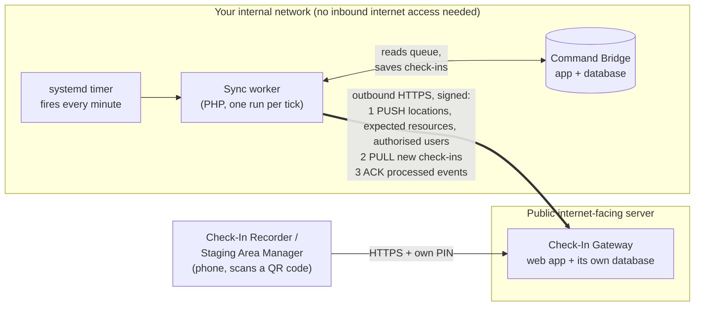

# Command Bridge

Command Bridge is free, self-hosted software for running an **Incident Command System (ICS)** response: incidents and
operational periods, positions and chain of command, ICS Canada forms with sign-off and PDF export, resource tracking,
and resource check-in. It is built on PHP 8, MariaDB and Apache and installs on a plain Debian server.

> **Public beta - version 0.9.0-beta.2 (Command Bridge; Check-In Gateway 0.9.0-beta.1).** It is used operationally but has not had wide testing. Test your install,
> keep backups, and read [SECURITY.md](SECURITY.md) before putting real incident data in it.

## Two programs, two servers

This repository contains two programs that work together:

| Folder | What it is | Where it runs |
|---|---|---|
| [`command-bridge/`](command-bridge/) | The main ICS application: users, incidents, forms, resources, ECC display, admin. | **Inside your network.** Does not need to be reachable from the internet. |
| [`checkin-gateway/`](checkin-gateway/) | A tiny web app where Check-In Recorders and Staging Area Managers record arriving resources from a phone (via a QR code or link). | **On a publicly reachable server** (internet-facing, HTTPS). |

You can run Command Bridge on its own. The gateway is optional and is only needed when people **outside** your network
must check resources in.

### Why two servers?

Responders in the field cannot reach an internal server, and you should not expose your incident database to the
internet to let them. The gateway solves this: it sits on the public side with its **own separate database**, holds only
the small amount of information needed for check-in, and never connects to Command Bridge's database. Command Bridge
reaches *out* to the gateway; the gateway never reaches *in*.

## How they work together



The thick arrow always starts inside your network and points out. No inbound connection from the internet to Command Bridge is needed.

### The timer that polls the gateway

Command Bridge installs a systemd timer, `commandbridge-external-checkin-sync.timer`, that fires **once a minute** and runs
a one-shot worker (`command-bridge/app/bin/external_checkin_sync_worker.php`). Each run:

1. **Pushes** anything that changed since last time to the gateway: active check-in locations, the *expected resources* for
   each location, and which Check-In Recorder / Staging Area Manager PINs (as bcrypt verifiers, never plain PINs) are authorised where.
2. **Pulls** check-ins and exception events that people have recorded on the gateway since the last poll.
3. **Acknowledges** each event it processed. Until it is acknowledged the gateway keeps it and offers it again, so a
   network outage or a restart loses nothing; the worker retries with back-off.

Processed check-ins update the Resources Unit record and the linked ICS 211 (personnel) or ICS 218 (vehicles and equipment) entry.
Every request is signed with a shared secret (HMAC-SHA256) and has a time limit, so the gateway ignores anything that is
not from your Command Bridge. The **Sync status** page in Command Bridge shows what is queued, delivered or failed, and lets
an administrator retry stuck items.

The timer is installed by the Command Bridge installer but left **disabled** until the gateway exists. Enable it after
setting up the gateway (see below): `sudo systemctl enable --now commandbridge-external-checkin-sync.timer`.

### What the gateway knows (and does not)

* It receives only: location names/addresses, the expected resources for check-in (reference number, provider, type), and for
  each authorised recorder a display name, role, allowed locations and a PIN *verifier*.
* It never receives incident forms, other users, your incident database or any plain-text PIN.
* Failed PIN attempts are throttled (per address, per repeat offender, per location), with an admin tool to review and clear blocks.

## Getting started

Do you need check-in from outside your network? If not, install only Command Bridge.

1. **Command Bridge** (internal Debian 12/13 server, root access):
   ```bash
   cd command-bridge
   sudo ./install.sh
   ```
   Guided installer: packages, database, Apache, HTTPS (self-signed by default for internal servers), first administrator.
   See [command-bridge/docs/INSTALL.md](command-bridge/docs/INSTALL.md).
2. **Check-In Gateway** (separate, publicly reachable Debian 12/13 server with a DNS name such as `checkin.example.ca`):
   ```bash
   cd checkin-gateway
   sudo ./install.sh
   ```
   It asks for its address, HTTPS (Let's Encrypt recommended), and a shared secret, then prints the exact lines to copy into
   Command Bridge. See [checkin-gateway/docs/INSTALL.md](checkin-gateway/docs/INSTALL.md).
3. **Connect them:** put the printed values into `/etc/commandbridge/external_checkin_sync.env` on the Command Bridge server
   (`EXTERNAL_CHECKIN_ENABLED=1`, gateway URLs, key ID, secret), enable the timer above, and set `GATEWAY_SYNC_ENABLED=1` on
   the gateway. Details: [command-bridge/docs/EXTERNAL_CHECKIN.md](command-bridge/docs/EXTERNAL_CHECKIN.md).
4. Run the built-in self-check on Command Bridge ([command-bridge/docs/SMOKE_TEST.md](command-bridge/docs/SMOKE_TEST.md)).

Both installers use friendly `whiptail` dialogs on a terminal and plain prompts otherwise; both log to `/var/log/`.

## Requirements

* Debian 12 or 13 on each server (the installers install everything else), about 1 GB RAM for Command Bridge, less for the gateway.
* Command Bridge: outbound HTTPS to the gateway only if you use check-in.
* Gateway: ports 80 and 443 reachable from the internet (Let's Encrypt needs both), and a DNS name.

## Repository layout

```
CommandBridge/
├── command-bridge/   main ICS application  (install.sh, update.sh, app/, database/, docs/, deploy/)
├── checkin-gateway/  public check-in gateway (install.sh, update.sh, public/, app/, database/, docs/, deploy/)
├── LICENSE.txt       GNU AGPL-3.0
├── SECURITY.md
└── README.md         (this file)
```

Each folder is self-contained: its own `VERSION`, `CHANGELOG.md`, installer, updater and numbered database migrations.
Release notes: [command-bridge/CHANGELOG.md](command-bridge/CHANGELOG.md), [checkin-gateway/CHANGELOG.md](checkin-gateway/CHANGELOG.md).
Keep both servers on the same release when upgrading.

## Official forms

Command Bridge fills the ICS Canada form templates in `command-bridge/app/assets/pdf/official/`. They are redistributed from ICS Canada (https://www.icscanada.ca) and are not covered by the AGPL. See [command-bridge/docs/FORMS.md](command-bridge/docs/FORMS.md) and
[command-bridge/THIRD_PARTY.md](command-bridge/THIRD_PARTY.md).

## Licence

Both programs are free software under the **GNU Affero General Public License v3.0** ([LICENSE.txt](LICENSE.txt)). If you run a
modified version for users over a network, you must offer them the corresponding source; each program's footer links to this
repository for that purpose.
